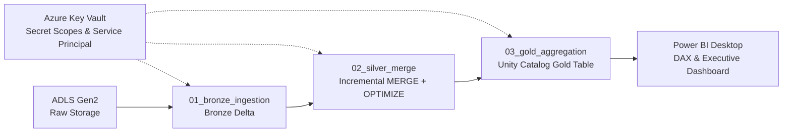

# Medallion Architecture Data Pipeline

## Overview
An end-to-end local data pipeline demonstrating the Medallion Architecture (Bronze, Silver, Gold). This project extracts raw nested JSON data, transforms it into a clean relational format, and aggregates it into business-ready metrics, fully orchestrated via Apache Airflow within a containerized Docker environment.

## Tech Stack
* **Languages:** Python, SQL
* **Data Processing:** Pandas
* **Orchestration:** Apache Airflow
* **Infrastructure:** Docker, Docker Compose
* **Version Control:** Git, GitHub

## Architecture Layers
1. **Bronze Layer (Ingestion):** Extracts raw, nested JSON payloads from external sources and lands them unchanged into the data lake.
2. **Silver Layer (Transformation):** Flattens nested arrays, enforces schema, and cleans raw data into structured, relational CSV files.
3. **Gold Layer (Aggregation):** Computes high-level business metrics (e.g., total user revenue) optimized for stakeholder dashboards and BI tools.

## Local Execution
To run this pipeline locally:
1. Clone this repository.
2. Initialize the Docker environment: `docker compose up -d`
3. Access the Airflow UI at `localhost:8080` to trigger the DAGs.

# Azure Medallion Lakehouse Pipeline (Databricks, Delta Lake & Power BI)

An end-to-end cloud data engineering pipeline built on **Microsoft Azure** implementing the **Medallion Architecture (Bronze → Silver → Gold)** with modular PySpark notebooks, incremental Delta Lake `MERGE` processing, multi-task Databricks Job orchestration, Unity Catalog governance, and Power BI reporting.

---

## Architecture



---

## Tech Stack
* **Cloud & Storage:** Azure Data Lake Storage Gen2 (ADLS Gen2)
* **Compute & Processing:** Azure Databricks, PySpark, Delta Lake
* **Governance & Security:** Unity Catalog, Azure Service Principal, Azure Key Vault (Secret Scopes)
* **Orchestration:** Azure Databricks Workflows (Multi-Task Dependent DAG)
* **BI & Visualization:** Power BI Desktop, DAX

---

## Repository Structure

```text
azure-medallion-pipeline/
├── notebooks/
│   ├── 00_config.py               # Shared ADLS paths & Key Vault secret-scope authentication
│   ├── 01_bronze_ingestion.py     # Raw data ingestion into Bronze Delta layer
│   ├── 02_silver_merge.py         # Data cleansing, incremental Delta MERGE, OPTIMIZE/ZORDER/VACUUM
│   └── 03_gold_aggregation.py     # Business aggregations & Unity Catalog table registration
├── powerbi_dashboard.png          # Executive dashboard preview
└── README.md
```

---

## Key Engineering Highlights
* **Zero Hardcoded Credentials:** Authenticated Databricks to ADLS Gen2 using an Azure Service Principal backed by **Azure Key Vault** secret scopes centralized in `00_config`.
* **Modular Pipeline Design:** Refactored monolithic ETL logic into decoupled, reusable notebooks to support independent debugging and Databricks **Repair Runs**.
* **Incremental Processing & Table Maintenance:** Implemented idempotent Delta Lake `MERGE` upserts in the Silver layer to handle updates without full reloads, followed by `OPTIMIZE`, `ZORDER`, and `VACUUM` for query performance and storage hygiene.
* **Multi-Task DAG Orchestration:** Configured `medallion-daily-etl-job` as a 3-task dependent workflow (`bronze_ingestion` → `silver_merge` → `gold_aggregation`) with job-level scheduling.
* **Analytics-Ready Gold Layer:** Published `dbw_medallion_prod.default.gold_sales_summary` to **Unity Catalog** and connected **Power BI Desktop** in Import mode to visualize revenue KPIs, customer spend distribution, and a custom **`Avg Order Value`** DAX measure.

---

## Power BI Dashboard


### Dashboard Metrics
* **Total Revenue & Total Orders:** Aggregated KPI cards sourced directly from `gold_sales_summary`.
* **Average Order Value (DAX):**
  ```dax
  Avg Order Value = DIVIDE(SUM(gold_sales_summary[total_spend]), SUM(gold_sales_summary[total_orders]), 0)
  ```
* **Customer Revenue Breakdown:** Clustered column chart and summary table tracking spend and order volume per customer.
